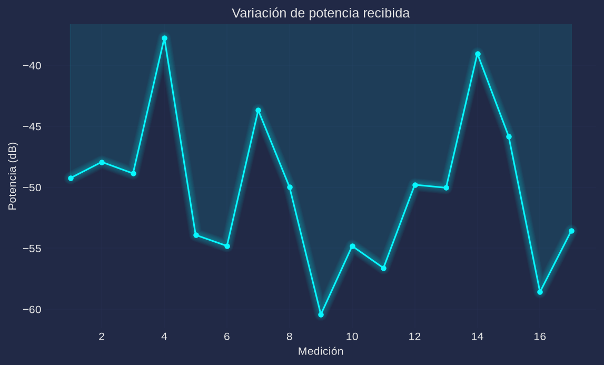
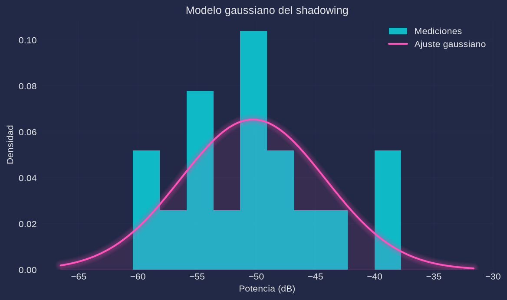

# Práctica 3. Caracterización experimental del shadowing log-normal

**Materia:** Comunicaciones Inalámbricas
**Equipo:** RTL-SDR (`RTL2832U` + tuner `R820T`), antena telescópica
**Fuente:** emisora FM 91.5 MHz (no se dispone de transmisor local en 433.9 MHz)
**Script:** [`practica3.py`](practica3.py) (Python; en este repo el análisis se hace en Python en lugar de MATLAB)

---

## 1. Objetivo

Caracterizar las variaciones lentas de potencia (shadowing o desvanecimiento de gran escala) de un canal inalámbrico real: medir la potencia recibida $P_r(k)$ en 17 posiciones independientes usando una emisora FM como fuente, estimar la media $\mu$ y la desviación estándar $\sigma$ del shadowing local, verificar si las mediciones siguen una distribución aproximadamente normal y obtener su ajuste gaussiano, complementando el modelo de pérdidas por trayectoria.

## 2. Fundamento teórico

Además de la pérdida media por trayectoria, la señal experimenta fluctuaciones lentas por obstáculos (edificios, paredes, mobiliario, vegetación, personas), modeladas por el shadowing log-normal:

$$PL(d) = PL(d_0) + 10\,n\,\log_{10}\!\left(\frac{d}{d_0}\right) + X_\sigma, \qquad X_\sigma \sim \mathcal{N}(0, \sigma^2)$$

donde $PL(d_0)$ es la pérdida a la distancia de referencia, $n$ el exponente de pérdidas y $X_\sigma$ una variable aleatoria gaussiana en dB de media cero y desviación estándar $\sigma$.

La potencia recibida de cada medición se estima de las muestras IQ como

$$P = \frac{1}{M}\sum_{m=1}^{M} |x[m]|^2, \qquad P_r(k) = 10\log_{10}(P)\ \text{(dB)}$$

y los estimadores muestrales de la media y la desviación estándar son

$$\mu = \frac{1}{N}\sum_{k=1}^{N} P_r(k), \qquad \sigma = \sqrt{\frac{1}{N-1}\sum_{k=1}^{N}\left(P_r(k)-\mu\right)^2}$$

El ajuste gaussiano se obtiene por máxima verosimilitud con `scipy.stats.norm.fit` ($\mu_{fit}$, $\sigma_{fit}$). Si se remueve la pérdida media por trayectoria, las fluctuaciones residuales deben aproximarse a $\mathcal{N}(0,\sigma^2)$, de modo que la normalidad de $P_r$ se contrasta con la prueba de Shapiro-Wilk. Valores típicos de $\sigma$:

| Entorno | σ (dB) |
|---|---|
| Espacio libre | 2 – 4 |
| Exterior urbano | 6 – 10 |
| Interior oficinas | 4 – 12 |
| Entornos industriales | 8 – 15 |

## 3. Desarrollo experimental

### 3.1 Configuración del receptor

| Parámetro | Valor |
|---|---|
| Frecuencia central | 91.5 MHz (emisora FM; no hay transmisor local en 433.9 MHz) |
| Sample rate | 2.4 MSPS |
| Muestras por medición | un bloque IQ de la fuente en vivo |
| Mediciones independientes | 17 |
| Distancia transmisor–receptor | no controlada (fuente lejana) |
| Ganancia (`--gain`) | auto (la mayor que no recorta el ADC) |
| Ritmo entre mediciones | manual: `ESPACIO` en cada posición |
| Antena | telescópica del RTL-SDR |

### 3.2 Escenario

La fuente es la emisora FM de 91.5 MHz, que llega desde un transmisor lejano; la distancia no se controla. La antena/receptor se reubicó entre mediciones en posiciones cercanas dentro del mismo entorno (pasillo, interior, cerca de paredes y puertas, con presencia/ausencia de personas) para excitar el shadowing local y el multitrayecto, manteniendo la fuente fija.

### 3.3 Procedimiento

1. `python3 practica3.py` abre una sola ventana en vivo con el espectro, la serie de potencias y el histograma con el ajuste gaussiano.
2. En cada una de las 17 posiciones se pulsa `ESPACIO` para registrar $P_r(k) = 10\log_{10}(\text{mean}(|x|^2))$ del último bloque IQ; `r` reinicia las mediciones.
3. La tecla `s` guarda las mediciones en `datos/mediciones.csv` (índice y potencia en dB).
4. Al guardar se calculan $\mu$, $\sigma$, el ajuste gaussiano, el intervalo de confianza aproximado de $\sigma$ y la prueba de normalidad; todo se guarda en `datos/resultados.json`.
5. La misma tecla `s` genera `figs/variacion.png` y `figs/histograma.png`.

## 4. Código

El script completo está en [`practica3.py`](practica3.py). Fragmentos esenciales:

```python
def tecla(self, ev):                                        # al pulsar ESPACIO
    self.registrar(comun.potencia_dbfs(self.app.fuente.ultimo))  # Pr(k)=10*log10(P)
mu, sigma = float(np.mean(Pr)), float(np.std(Pr, ddof=1))                      # mu=mean(Pr); sigma=std(Pr)
mu_fit, sigma_fit = stats.norm.fit(Pr)                                         # pd=fitdist(Pr,'Normal')
p = stats.shapiro(Pr).pvalue                                                   # prueba de normalidad
ax.hist(Pr, bins=10, density=True)                                             # histogram(Pr,'Normalization','pdf')
ax.plot(x, stats.norm.pdf(x, mu_fit, sigma_fit))                               # plot(x, pdf(pd,x))
```

## 5. Resultados

La corrida real se realizó con el RTL-SDR y la antena telescópica sintonizados en la emisora FM de **91.5 MHz**. Se registraron **17 posiciones** distintas dentro del mismo entorno; la fuente es lejana, así que la distancia no se controló y lo que se caracteriza es el shadowing local (no la pérdida media por trayectoria).

### 5.1 Tabla de resultados

| Parámetro | Valor |
|---|---|
| Media µ (dBFS) | −50.29 |
| Desviación σ (dB) | 6.29 |
| σ del ajuste gaussiano (MLE) | 6.10 |
| N mediciones | 17 |
| Fuente | FM 91.5 MHz |
| Distancia | no controlada (fuente lejana) |
| p-valor (Shapiro-Wilk) | 0.6580 |
| IC 95 % aproximado de σ | [4.11, 8.47] dB |
| Entorno (clasificado por σ) | exterior urbano / interior con obstáculos |

### 5.2 Variación de potencia recibida



La potencia fluctúa alrededor de −50.3 dBFS con excursiones entre aproximadamente −60.4 y −37.8 dBFS. Esa dispersión de más de 20 dB es la firma del shadowing local y del multitrayecto al mover la antena entre posiciones. No se observa una tendencia monótona porque la distancia a la emisora no cambia de forma controlada; lo que varía es el entorno local.

### 5.3 Histograma y ajuste gaussiano



El histograma normalizado presenta una forma aproximadamente acampanada y la gaussiana ajustada lo sigue de cerca. Con solo 17 muestras el histograma es grueso, pero no se aprecian bimodalidades ni colas pesadas evidentes.

## 6. Análisis de resultados

- **Normalidad:** el p-valor de Shapiro-Wilk (0.6580) es muy superior a 0.05, por lo que **no se rechaza** la hipótesis de normalidad de $P_r$; las 17 mediciones son compatibles con el modelo log-normal del shadowing. La media del ajuste coincide con la muestral (−50.29 dBFS) y la diferencia entre $\sigma$ muestral (6.29 dB) y $\sigma_{fit}$ (6.10 dB) se debe al estimador ($N-1$ vs. máxima verosimilitud).
- **Comparación con la literatura:** $\sigma = 6.29$ dB cae dentro del rango de **interior de oficinas (4–12 dB)** y en el borde inferior de exterior urbano (6–10 dB). Está por encima del espacio libre (2–4 dB), lo que es consistente con un entorno con paredes, muebles, puertas y personas. El intervalo de confianza [4.11, 8.47] dB es amplio por el tamaño de muestra, pero cubre los valores típicos de interiores.
- **Elementos del entorno:** paredes, puertas y la presencia de personas son los obstáculos que más modifican la potencia recibida; al mover la antena cambian las atenuaciones y las fases de las réplicas multitrayecto, aunque la distancia a la emisora sea prácticamente constante.
- **Pérdida por trayectoria vs. shadowing:** con una emisora lejana no se puede medir el exponente $n$ de path loss, porque la distancia no se controla. Esta práctica caracteriza únicamente la componente aleatoria $X_\sigma$ alrededor de la potencia media local; para el modelo completo $PL(d)$ haría falta un transmisor local a distancias conocidas.
- **Hardware:** la corrida fue real, con el RTL-SDR y la antena; no se usó `--sim`. Las potencias son dBFS relativas al ADC del receptor, no dBm absolutos, pero $\sigma$ es independiente de la escala y por eso es la métrica robusta del shadowing.

## 7. Cuestionario

1. **¿Qué es el shadowing?**
   Es el desvanecimiento de gran escala: las variaciones lentas de la potencia media recibida causadas por obstáculos que bloquean, absorben o difractan la señal (edificios, paredes, árboles, personas). Se modela superponiendo a la pérdida por trayectoria una variable aleatoria gaussiana en dB, $X_\sigma \sim \mathcal{N}(0,\sigma^2)$, de modo que la potencia lineal resulta log-normal.

2. **¿Qué diferencia existe entre fading de gran escala y de pequeña escala?**
   El fading de gran escala (shadowing) se debe a obstáculos entre transmisor y receptor y varía lentamente, sobre distancias de muchos metros o cientos de longitudes de onda; afecta la potencia media local. El de pequeña escala (multitrayectoria, Rayleigh/Rician) se debe a la interferencia de réplicas que llegan con retrasos y fases distintas, varía rápidamente (distancias del orden de $\lambda$ o fracciones) y produce desvanecimientos profundos y selectivos en frecuencia.

3. **¿Por qué el shadowing suele modelarse log-normal?**
   Porque la pérdida en dB producida por cada obstáculo es aditiva: la atenuación total es la suma de muchas contribuciones independientes. Por el teorema central del límite, esa suma tiende a una distribución gaussiana, por lo que la pérdida en dB (el logaritmo de la potencia lineal) es normal; en consecuencia, la potencia lineal sigue una distribución log-normal.

4. **¿Qué representa físicamente σ?**
   La dispersión o intensidad del shadowing: cuánto se apartan las mediciones de la pérdida media por trayectoria a una misma distancia. Físicamente resume la agresividad y variabilidad de los obstáculos del entorno: a mayor $\sigma$, mayor incertidumbre en el nivel de potencia recibida y peor predictibilidad del enlace.

5. **¿Cómo afecta el entorno interior al valor de σ?**
   Lo incrementa respecto del espacio libre (4–12 dB frente a 2–4 dB), porque en interiores hay gran cantidad y variedad de obstáculos (muros, divisiones, muebles, puertas, personas en movimiento) con atenuaciones muy distintas entre posiciones. Ambientes interiores abiertos o con línea de vista directa tienden al extremo inferior del rango, mientras que oficinas densamente amuebladas o con tráfico de personas se acercan al extremo superior.

## 8. Conclusiones

Se ejecutó la corrida real del análisis de shadowing con el RTL-SDR y la antena telescópica, usando la emisora FM de 91.5 MHz como fuente y 17 posiciones distintas. Se obtuvo $\mu = -50.29$ dBFS, $\sigma = 6.29$ dB, $\sigma_{fit} = 6.10$ dB y $p = 0.6580$ en la prueba de Shapiro-Wilk, de modo que no se rechaza la normalidad y el valor de $\sigma$ es consistente con un entorno interior con obstáculos moderados (4–12 dB). La ausencia de un transmisor local en 433.9 MHz impide medir path loss con distancias controladas; por eso la práctica se limitó al shadowing local con una fuente FM lejana. El procedimiento queda reproducible con `python3 practica3.py -f 91.5e6 -d 0`, la tecla `ESPACIO` en cada posición y `s` para guardar.
