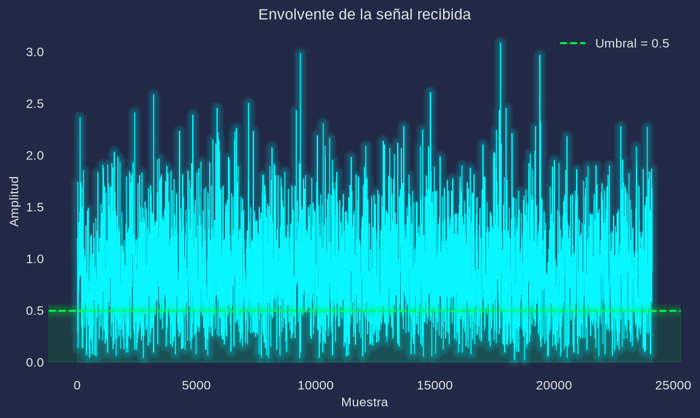
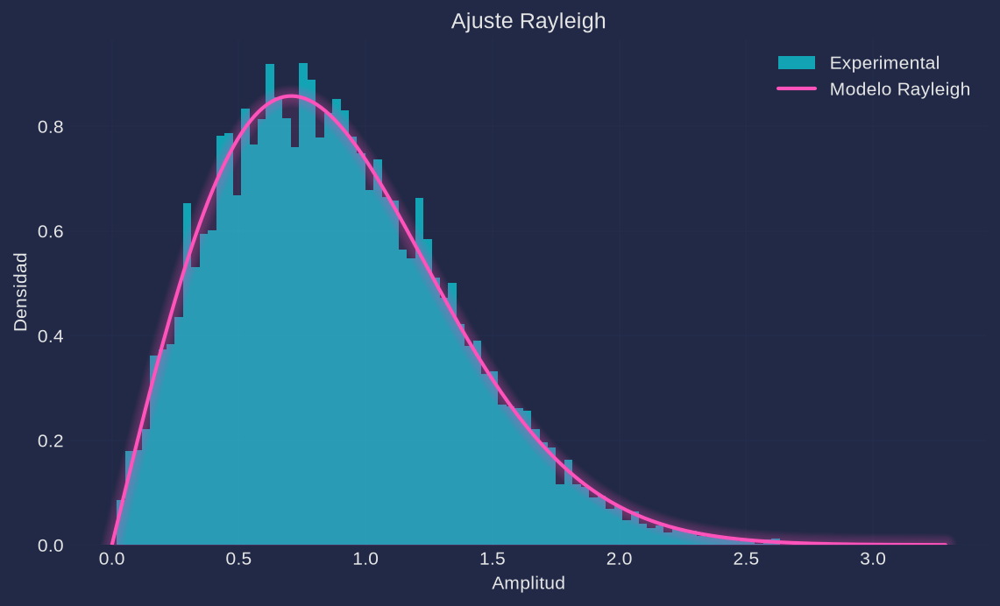

# Práctica 4. Caracterización experimental del desvanecimiento Rayleigh

**Materia:** Comunicaciones Inalámbricas
**Equipo:** RTL-SDR (`RTL2832U` + tuner `R820T`), antena telescópica
**Fuente:** emisora FM 90.0 MHz (emisora débil, para que el multitrayecto domine; no hay transmisor local en 433.9 MHz)
**Script:** [`practica4.py`](practica4.py) (Python; en este repo el análisis se hace en Python en lugar de MATLAB)

---

## 1. Objetivo

Caracterizar experimentalmente el desvanecimiento de pequeña escala de un canal inalámbrico mediante el análisis estadístico de la envolvente de la señal recibida con el RTL-SDR: observar las fluctuaciones rápidas de amplitud causadas por multitrayectoria, construir el histograma de amplitudes, verificar el ajuste de una distribución Rayleigh, cuantificar el porcentaje de desvanecimientos profundos y relacionar las mediciones con el modelo teórico de fading Rayleigh.

## 2. Fundamento teórico

La señal de banda base recibida es compleja, $x[n] = I[n] + jQ[n]$, y su envolvente (amplitud instantánea) es

$$r[n] = |x[n]| = \sqrt{I[n]^2 + Q[n]^2}$$

En un canal sin trayectoria directa dominante, la señal llega al receptor por múltiples reflexiones, difracciones y dispersión. Cada réplica llega con una fase aleatoria; por el teorema central del límite, la suma de muchas contribuciones independientes y de potencia comparable hace que $I$ y $Q$ sean gaussianas independientes de media cero y varianza $\sigma^2$. En ese caso la envolvente sigue una **distribución Rayleigh**:

$$f(r) = \frac{r}{\sigma^2}\,e^{-r^2/(2\sigma^2)}, \qquad r \ge 0$$

con CDF

$$F(r) = 1 - e^{-r^2/(2\sigma^2)}$$

y momentos $E[r] = \sigma\sqrt{\pi/2}$, $E[r^2] = 2\sigma^2$ y $\mathrm{std}(r) = \sigma\sqrt{2 - \pi/2}\approx 0.655\,\sigma$.

La normalización de la práctica, $r \leftarrow r/\sqrt{\mathrm{mean}(r^2)}$, fuerza $E[r^2]=1$, es decir $\sigma = 1/\sqrt{2} \approx 0.7071$, con lo que los valores esperados son $E[r] \approx 0.886$ y $\mathrm{std}(r) \approx 0.463$.

Un **desvanecimiento profundo** es una caída de la envolvente por debajo de un umbral bajo. Su probabilidad se obtiene de la CDF:

$$P(r < r_{\text{umbral}}) = 1 - e^{-r_{\text{umbral}}^2/(2\sigma^2)}$$

Para $r_{\text{umbral}} = 0.5$ y $\sigma = 1/\sqrt{2}$ resulta $P = 1 - e^{-0.25} \approx 22.1\%$. Físicamente ocurre cuando las réplicas multitrayecto se cancelan de forma casi destructiva (fases opuestas), lo que produce caídas de decenas de dB respecto al valor RMS.

## 3. Desarrollo experimental

### 3.1 Configuración del receptor

| Parámetro | Valor |
|---|---|
| Frecuencia central | **90.0 MHz** (emisora FM débil; se eligió para evitar una trayectoria directa dominante) |
| Sample rate | 2.4 MHz |
| Ventana de análisis | 10.0 s de captura real |
| Envolvente analizada | ventana de `--dur` segundos decimada 1:1000 |
| Filtro IF del tuner | 0.6 MHz |
| Ganancia | automática calibrada (la mayor sin recorte del ADC) |
| Umbral de fading profundo | 0.5 (relativo al valor RMS normalizado) |

> Nota técnica: la lectura es asíncrona (`vivo.Fuente`) para no perder muestras; el análisis estadístico se hace sobre **toda** la ventana móvil y solo la gráfica temporal se decima para no saturar la figura.

### 3.2 Procedimiento

1. Sintonizar una emisora FM débil (90.0 MHz) para que la componente directa no domine.
2. Mantener el receptor en la mano y **caminar varios metros durante la captura** (velocidad de caminata), en un entorno interior con paredes, puertas y mobiliario que generen reflexiones y bloqueos.
3. Capturar 10 s de IQ con el RTL-SDR; la envolvente y el histograma se calculan sobre toda la ventana. Repetir cambiando la ruta para excitar distintas realizaciones del canal.
4. Sobre la ventana móvil el script calcula la envolvente $r=|x|$, la normaliza ($r/\sqrt{\mathrm{mean}(r^2)}$), construye su histograma normalizado a pdf y ajusta una distribución Rayleigh con `scipy.stats.rayleigh.fit(r, floc=0)`.
5. Cuenta las muestras con $r < 0.5$ y compara el porcentaje con el valor teórico $1-e^{-r_{\text{umbral}}^2/(2\sigma^2)}$ usando el $\sigma$ ajustado.
6. La tecla `s` guarda las figuras en `figs/` y los resultados en `datos/resultados.json`.

Para verificar el análisis sin hardware pueden usarse `--sim` (fading Rayleigh sintético con correlación temporal) y `--selftest`.

## 4. Código

El script completo está en [`practica4.py`](practica4.py). Fragmentos esenciales:

```python
r = self.ventana()                                                     # ESPACIO: |x| normalizada de la ventana móvil
sigma = rayleigh.fit(r, floc=0)[1]                                     # pd = fitdist(r,'Rayleigh')
pct = 100 * np.mean(r < args.umbral)                                   # Porcentaje = 100*Ndeep/length(r)
pct_teorico = 100 * (1 - np.exp(-args.umbral**2 / (2 * sigma**2)))
```

En `--sim` el fading se genera con `vivo.rayleigh_sim` (suma de sinusoides con $f_d$ ajustable por `--fd`) y el pipeline posterior es idéntico al de la captura real.

## 5. Resultados

La corrida real se hizo con el RTL-SDR y la antena telescópica sintonizados en la emisora FM de **90.0 MHz**, una emisora débil elegida para que el multitrayecto dominara sobre la trayectoria directa. Se capturaron **10 s** de IQ mientras se movía la antena/receptor por el entorno.

### 5.1 Mediciones

| Parámetro | Valor |
|---|---|
| Frecuencia de operación | 90.000 MHz |
| Cantidad de muestras de envolvente | 24 118 |
| Media de amplitud | 0.8885 |
| Desviación estándar | 0.4589 |
| Porcentaje de fading profundo ($r<0.5$) | **21.70 %** |
| $\sigma$ Rayleigh ajustado (`fitdist`) | 0.7071 |
| Porcentaje teórico con el $\sigma$ ajustado | 22.12 % |

Los resultados completos quedan en `datos/resultados.json`.

### 5.2 Envolvente temporal



La envolvente normalizada muestra fluctuaciones rápidas con caídas profundas y picos; la línea punteada marca el umbral de 0.5. El movimiento de la antena cambia las fases relativas de las réplicas y produce los desvanecimientos característicos.

### 5.3 Histograma y ajuste Rayleigh



El histograma normalizado sigue de cerca la curva Rayleigh ajustada ($\sigma = 0.7071$). La media medida (0.8885) y la desviación (0.4589) son prácticamente las teóricas de Rayleigh normalizada (0.8862 y 0.4633), y el porcentaje de fading profundo (21.70 %) coincide con el teórico (22.12 %) dentro de la resolución estadística.

## 6. Análisis de resultados

- **¿Se aproxima a Rayleigh?** Sí. El $\sigma$ ajustado es $0.7071 = 1/\sqrt{2}$, consistente con la normalización $E[r^2]=1$; la media medida (0.8885) coincide con la teórica $0.8862$ y la desviación (0.4589) con $0.4633$. El histograma sigue la forma característica de Rayleigh y el porcentaje de fading profundo es casi idéntico al teórico.
- **Desvanecimientos profundos:** con umbral 0.5 se obtuvo 21.70 % de las muestras, prácticamente el teórico 22.12 %. La coincidencia es buena porque la emisora débil y el movimiento excitaron multitrayecto sin una componente directa dominante.
- **Relación con multitrayectoria:** las caídas hasta amplitud casi nula corresponden a cancelaciones destructivas entre réplicas con fases opuestas. El movimiento del receptor cambia continuamente las longitudes de camino (fracciones de longitud de onda) y con ello las fases relativas, produciendo el vaivén de la envolvente. Si existiera una trayectoria directa dominante, el histograma se desplazaría hacia una distribución Rician (con pico desplazado) y ya no sería Rayleigh puro; el parámetro `--los` del script permite observar esa transición.
- La corrida fue real, con el RTL-SDR y la antena; no se usó `--sim`. El experimento es reproducible: `--sim` verifica el pipeline sin dongle y `--selftest` comprueba el ajuste y el umbral con Rayleigh iid (22.1 % teórico).

## 7. Cuestionario

1. **¿Qué es el desvanecimiento Rayleigh?**
   Es el modelo estadístico del fading de pequeña escala en un canal sin trayectoria directa dominante. La señal recibida es la suma de muchas réplicas multitrayecto con fases aleatorias; las componentes $I$ y $Q$ resultan gaussianas independientes de media cero y la envolvente $r=\sqrt{I^2+Q^2}$ sigue una distribución Rayleigh, con pdf $f(r)=\frac{r}{\sigma^2}e^{-r^2/(2\sigma^2)}$. Describe fluctuaciones rápidas de amplitud (escala de fracciones de longitud de onda) y se usa ampliamente en canales móviles urbanos e interiores.

2. **¿Cuál es la diferencia entre shadowing y fading Rayleigh?**
   El *shadowing* es una variación **lenta y de gran escala** de la potencia media local, causada por obstáculos grandes (edificios, colinas, muros) que bloquean la señal; típicamente se modela como log-normal (gaussiana en dB) y cambia al recorrer distancias de decenas o cientos de metros. El *fading Rayleigh* es una variación **rápida y de pequeña escala** debida a la interferencia constructiva/destructiva entre réplicas locales; cambia al moverse fracciones de longitud de onda. En un enlace real ambos se superponen: path loss + shadowing fijan la potencia media local y sobre ella actúa el fading rápido Rayleigh.

3. **¿Qué condiciones favorecen un canal Rayleigh?**
   La ausencia de una trayectoria directa dominante (NLOS) y la presencia de muchos dispersores con potencias comparables y fases aleatorias: ambientes urbanos densos, interiores con paredes, puertas y mobiliario, y movimiento relativo entre transmisor y receptor. También contribuye que la señal dispersada domine sobre cualquier componente especular.

4. **¿Qué es un desvanecimiento profundo?**
   Es una caída de la amplitud recibida por debajo de un umbral bajo (p. ej. $r<0.5$ respecto a la RMS normalizada, o 10–20 dB por debajo del valor típico), producida por la cancelación casi total de las réplicas multitrayecto. Según la CDF Rayleigh, con umbral 0.5 ocurre aproximadamente el 22 % del tiempo; para caídas de −20 dB el porcentaje es ~1 %. En un enlace digital se manifiesta como ráfagas de errores concentradas en los instantes de caída.

5. **¿Cómo se relaciona la multitrayectoria con la distribución Rayleigh?**
   Cada trayectoria aporta una copia con amplitud y fase aleatorias. Al sumar un número grande de contribuciones independientes y de potencia similar, el teorema central del límite hace que las componentes en fase y cuadratura sean gaussianas de media cero. La envolvente de dos gaussianas de media cero es precisamente Rayleigh; por eso la multitrayectoria sin componente directa es el origen físico de esta distribución.

6. **¿Qué impacto tiene el fading Rayleigh en el desempeño de un sistema de comunicaciones?**
   Las caídas profundas reducen la SNR instantánea decenas de dB, incrementan la BER y producen errores en ráfaga, reduciendo throughput y disponibilidad; además obligan a márgenes de enlace mayores que en AWGN. En canales selectivos en frecuencia el desvanecimiento distorsiona los símbolos (ISI). Se mitiga con diversidad espacial, temporal (entrelazado + codificación), frecuencial (OFDM/ecualización), MIMO, control adaptativo de potencia y ARQ.

## 8. Conclusiones

Se ejecutó la corrida real de caracterización del desvanecimiento Rayleigh con el RTL-SDR y la antena telescópica, usando la emisora FM de 90.0 MHz como fuente débil y una captura de 10 s mientras se movía el receptor. La envolvente normalizada dio $\sigma = 0.7071$, media 0.8885, desviación 0.4589 y 21.70 % de muestras bajo 0.5, frente al 22.12 % teórico. Los valores son consistentes con una distribución Rayleigh y confirman que, en ausencia de trayectoria directa dominante, el multitrayecto y el movimiento del receptor producen los desvanecimientos profundos predichos por el modelo. La falta de un transmisor local en 433.9 MHz se suplió con una emisora FM débil; el procedimiento queda reproducible sintonizando 90.0 MHz y capturando la envolvente con el RTL-SDR.
